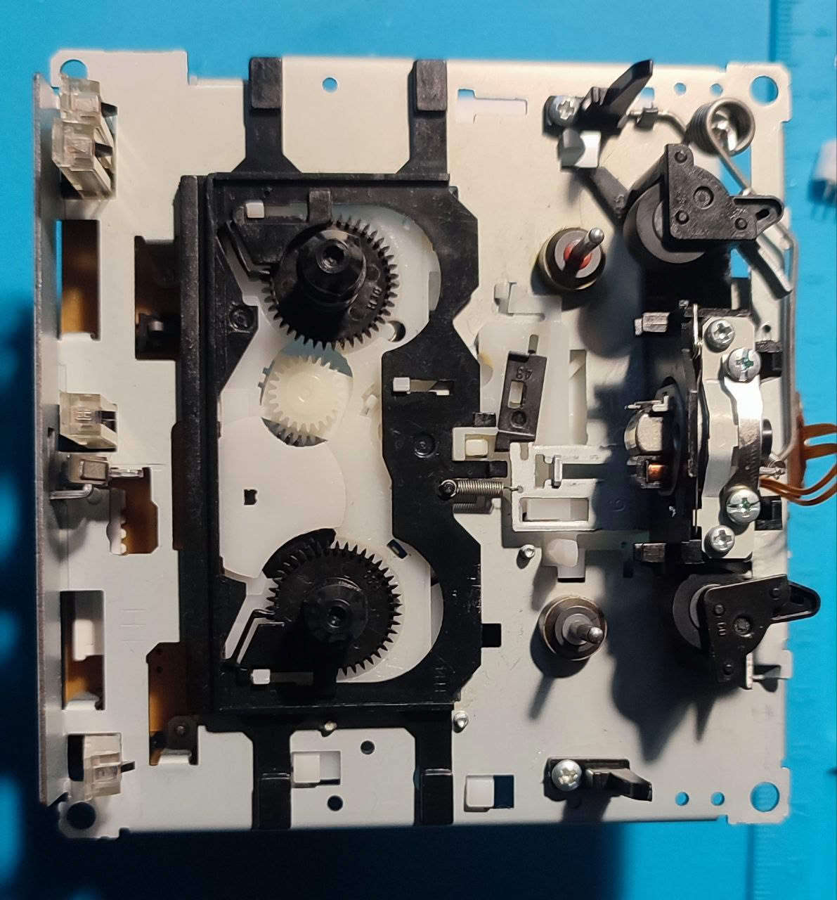
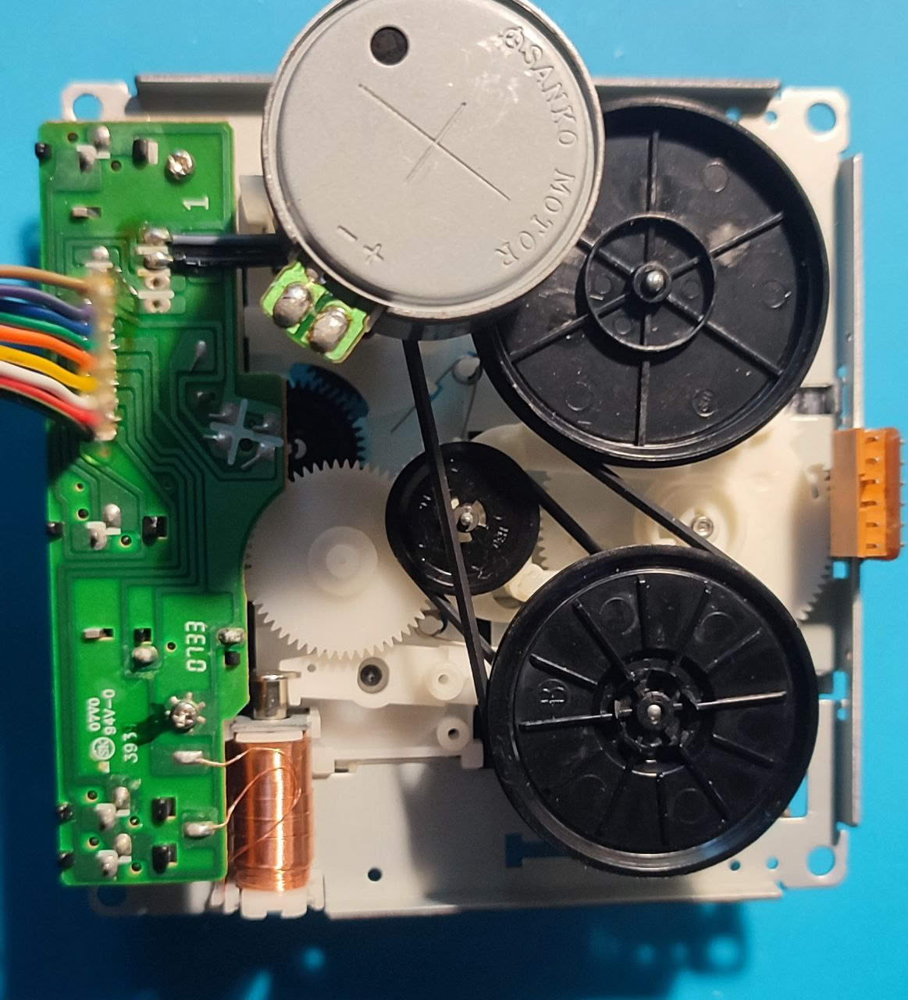

# CortexTapeControl

Прошивка управления кассетным механизмом **CRP42602Y** (M02753900D) на STM32F072CB.
Машина состояний портирована из [AVRTapeControl](https://github.com/Fagear/AVRTapeControl),
логика и тайминги разобраны в [docs/mech/crp42602y.md](docs/mech/crp42602y.md).

Текущая версия: **0.1.0** (`app/version.h`).

| Лицевая сторона | Обратная сторона |
|---|---|
|  |  |

## Возможности

* Режимы `Stop`, `Play Fwd/Rev`, `Rec Fwd/Rev`, `Fw Fwd/Rev` (`mech::UserMode`).
* Переключения по циклограммам с тайм-базой 2 мс: соленоид получает короткие импульсы,
  головка, прижим и подмотка выбираются по времени; `MUTE` и `REC_EN` — по циклу.
* Контроль ошибок: проверка HOME в конце цикла, до 6 повторов возврата в STOP, режим `HALT`.
* USB CDC с протоколом COBS + CRC32, логи — SEGGER RTT.

## Железо

* Плата: [cortex_tape_control_pcb_v1](https://github.com/Mcublog/cortex_tape_control_pcb_v1)
* Схема: `docs/sch/v1_2/CortexTapeControl_v1.2.pdf`
* Распиновка разъёма механизма: [docs/pinout.md](docs/pinout.md)

## Сборка

Нужен ARM GNU Toolchain (`arm-none-eabi-gcc`).

```bash
git submodule update --init --recursive   # libs/SoftwareTimer

TC=~/.local/bin/arm-gnu-toolchain-14.2.rel1-x86_64-arm-none-eabi/bin
cmake -S . -B build -G Ninja -DCMAKE_BUILD_TYPE=Debug \
  -DCMAKE_C_COMPILER=$TC/arm-none-eabi-gcc \
  -DCMAKE_CXX_COMPILER=$TC/arm-none-eabi-g++ \
  -DCMAKE_ASM_COMPILER=$TC/arm-none-eabi-gcc \
  -DCMAKE_EXPORT_COMPILE_COMMANDS=ON

cmake --build build                       # всё
cmake --build build --target fw_ctc_v1    # только прошивка
```

| Build type | Флаги | Особенности |
|---|---|---|
| `Debug` | `-Og -g3` | по умолчанию |
| `Release` | `-Os -s` | минимальный размер |
| `RelWithDebInfo` | `-Os -g3` | включает `FORCE_LOG` (логи и на desktop) |

Собираются: прошивка `fw_ctc_v1`, эмулятор `emu_ctc_v1` (всегда host x86-64) и пять
hwtest-сборок `hwtest_ctc_v1_{shiftreg,solenoid,buttons,inputs,analog_scale}`.
`*.hex` складываются в `build/output/` (путь захардкожен в `cmake/utils.cmake`).

## Прошивка платы

```bash
JLink -CommanderScript build/targets/ctc_v1/fw_ctc_v1.jlink
```

Скрипт генерируется CMake, hex берётся из `build/output/`.

## Тесты

`test/` не входит в корневую сборку и собирается отдельно host-компилятором:

```bash
cmake -S test/mech -B build_mech_test -G Ninja
cmake --build build_mech_test
./build_mech_test/mech_test      # успех: "126 checks, 0 failures", exit code 0
```

`err> mech: transport error` в выводе — ожидаемые сообщения негативных кейсов.

## Эмулятор и tapecli

Без платы: `socat` поднимает пару виртуальных портов, эмулятор открывает `/dev/ttyS11`,
CLI — `/dev/ttyS10`.

```bash
pip install -e scripts/tapecli          # один раз, в venv
./scripts/nullmodem_tty.sh
./build/targets/emu/emu_ctc_v1
tapecli -p /dev/ttyS10 play-fwd
```

`scripts/tapecli/` — Python-клиент протокола, править только `src/` (`build/lib/` —
устаревшая копия). Команды задаются подкомандами, JSON-файлов больше нет:

```bash
tapecli -p /dev/ttyS10 version          # версия прошивки
tapecli -p /dev/ttyS10 state            # состояние механизма
tapecli -p /dev/ttyS10 stop             # стоп
tapecli -p /dev/ttyS10 play-fwd         # воспроизведение вперёд
tapecli -p /dev/ttyS10 play-rev         # воспроизведение назад
tapecli -p /dev/ttyS10 rewind-fwd       # перемотка вперёд
tapecli -p /dev/ttyS10 rewind-rev       # перемотка назад
tapecli -p /dev/ttyS10 set-mode 1       # низкоуровневый mech::UserMode (0–6)
tapecli -p /dev/ttyS10 solenoid --pull-ms 400 --cooldown-ms 100
```

`state` печатает состояние по смыслу: пользовательский режим и режим транспорта
(`SubAct -> PbFwd`), остаток перехода в тиках и мс, счётчик повторов, ошибку, датчики,
направление и состояние ведущего двигателя.

## Протокол

Кадры COBS (`libs/cobs-c`), внутри заголовок с `channel`, `version`, `size` и CRC32,
далее 32-битный id команды и payload. Структуры — `app/proto/commands.h`,
точка входа — `app/process/communication/process.cpp`.

| id | Команда | Запрос | Ответ |
|---|---|---|---|
| `0x00` | `CMD_UNKNOWN` | — | ack с ошибкой |
| `0x01` | `CMDID_GET_VERSION` | — | `char version[32]` |
| `0x02` | `CMDID_SOLENOID_PULL` | `uint32 pull_time_ms`, `uint32 cooldown_ms` | `uint32 error` |
| `0x03` | `CMDID_MECH_SET_MODE` | `uint32 mode` (0–6) | `uint32 error`: 0 — ok, 1 — неверный режим, 2 — отклонено, 3 — нет обработчика |
| `0x04` | `CMDID_MECH_GET_STATE` | — | `mech_state_t` |
| `0x05` | `CMDID_MECH_TRANSPORT` | `uint32 action` | `uint32 error`: 0 — ok, 1 — неверное действие, 2 — отклонено, 3 — нет обработчика |

`CMDID_MECH_TRANSPORT` — высокоуровневые команды транспорта: вместо числового режима
передаётся действие.

| `action` | Значение | `mech::UserMode` |
|---|---|---|
| `0` | `MECH_ACTION_STOP` | `Stop` |
| `1` | `MECH_ACTION_PLAY_FWD` | `PlayFwd` |
| `2` | `MECH_ACTION_PLAY_REV` | `PlayRev` |
| `3` | `MECH_ACTION_REWIND_FWD` | `FwindFwd` |
| `4` | `MECH_ACTION_REWIND_REV` | `FwindRev` |

`mech_state_t` (все поля `uint32`): `mode`, `target_mode`, `user_mode`, `transition`,
`retries`, `error`, `sensors`, `last_dir`, `capstan`. Биты `sensors`: HOME — `0x01`,
тахо — `0x02`, кассета — `0x04`, без записи FWD — `0x08`, без записи REV — `0x10`.

## Структура репозитория

```
app/                        общий код: mech, proto, process, ui, events, io
arch/{stm32f0,desktop}/     системные интерфейсы (USB, GPIO, tty, таймеры)
bsp/{ctc_v1,desktop}/       MechIo, индикация, GPIO
targets/ctc_v1/             CubeMX-проект и сборка прошивки
targets/emu/                эмулятор и io_mock
hwtest/pcb_ctc_v1/          тесты узлов платы
test/mech/                  host-тесты машины состояний
scripts/tapecli/            Python-клиент протокола
docs/                       mech/, pinout.md, схемы, фото
libs/                       SoftwareTimer (submodule), Ring-Buffer, cobs-c, debug
```

## Документация

* [docs/mech/crp42602y.md](docs/mech/crp42602y.md) — циклограммы, режимы, тайминги и разбор
  оригинальной прошивки AVRTapeControl
* [docs/pinout.md](docs/pinout.md) — распиновка разъёма механизма

## Ссылки

* [Original idea and project AVRTapeControl](https://github.com/Fagear/AVRTapeControl)
* [Cortex Tape Control pcb](https://github.com/Mcublog/cortex_tape_control_pcb_v1)
* [Another similar project pico_crp42602y_ctrl](https://github.com/elehobica/pico_crp42602y_ctrl)
