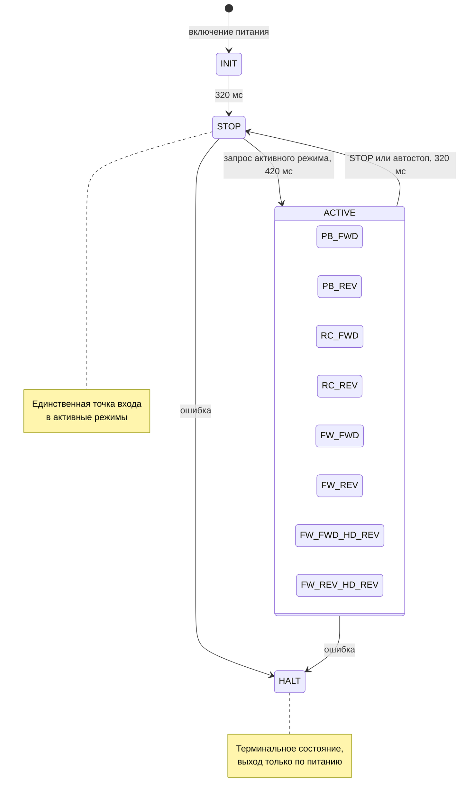
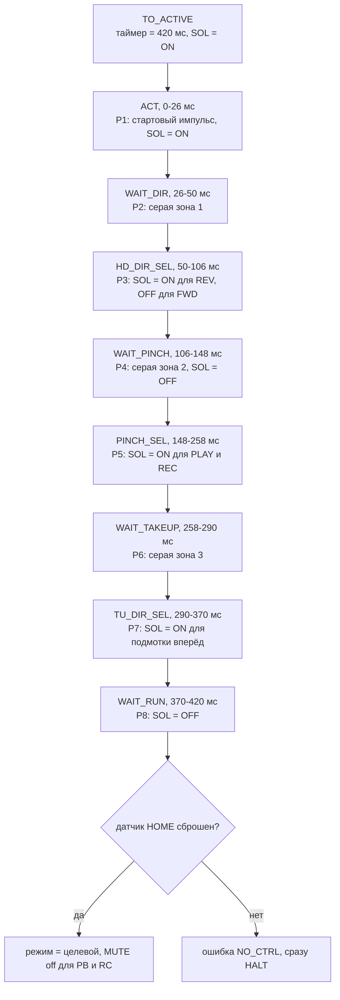

# CRP42602Y: циклограммы и логика управления

Разбор поведения оригинальной прошивки [AVRTapeControl](https://github.com/Fagear/AVRTapeControl)
для механизма **CRP42602Y** (он же M02753900D).

| | |
|---|---|
| Источник | `Fagear/AVRTapeControl`, ветка `main`, коммит `e2894a7` (2026-05-29) |
| Файлы | `AVRTapeControl/mech_crp42602y.c`, `mech_crp42602y.h`, `avrtape.c`, `drv_io.h`, `common_log.h` |
| Статус | описание поведения кода, а не паспорт механизма |

Документ фиксирует **что реально делает прошивка**, включая зависимости от предыдущего
состояния, которые не видны из описания в README оригинального проекта.

---

## 1. Механизм и допущения

CRP42602Y — одномоторный механизм с реверсом:

* **один двигатель** (capstan) через пассик вращает маховик, узел подмотки и **кулачковую шестерню**;
* **один соленоид** с собачкой, которая входит в зацепление с кулачковой шестернёй и
  переключает рычаги;
* датчики: **HOME/STOP** (механизм в исходном положении), **тахометр подмотки** (импульсы с
  ролика), **кассета**, два датчика защиты записи (FWD/REV);
* датчиков положения головки, прижимного ролика и направления подмотки **нет**.

Из этого следуют два принципиальных момента:

1. Положение механизма после переключения фиксируется механически (детенты), поэтому
   соленоид получает только **короткие импульсы** и не требует тока удержания.
2. Все три выбора внутри цикла (направление головки, прижим, направление подмотки)
   выполняются **без обратной связи, по времени**, пока кулачок проворачивается мотором.
   Прошивка предполагает, что цикл начинается из HOME, и проверяет это только в конце.

---

## 2. Обозначения

| Сигнал | Пин (ATmega328) | Смысл |
|---|---|---|
| `SOLENOID` | PB0 | соленоид, активный уровень «1» |
| `CAPSTAN` | PB1 | разрешение двигателя, «1» = включён |
| `MUTE` | PD0 | «1» = звук заглушён |
| `REC_EN` | PD7 | «1» = включена цепь записи (bias + режим УВ) |
| HOME/STOP | PD3 | «0» на пине = механизм в исходном положении (`TTR_SW_STOP`) |
| TACHO | PD2 | «0» на пине = активный уровень датчика |

Все датчики — активный низкий уровень (замыкание на GND), кнопки — тоже.

Моды транспорта (`mech_crp42602y.h:51-78`):

| Мода | Смысл |
|---|---|
| `TTR_42602_MODE_STOP` | стабильный STOP (HOME) |
| `TTR_42602_MODE_PB_FWD` / `PB_REV` | воспроизведение вперёд / назад |
| `TTR_42602_MODE_RC_FWD` / `RC_REV` | запись вперёд / назад |
| `TTR_42602_MODE_FW_FWD` | перемотка вперёд, головка осталась в положении FWD |
| `TTR_42602_MODE_FW_REV` | перемотка назад, головка в FWD |
| `TTR_42602_MODE_FW_FWD_HD_REV` | перемотка вперёд, головка в REV |
| `TTR_42602_MODE_FW_REV_HD_REV` | перемотка назад, головка в REV |
| `TTR_42602_MODE_HALT` | аварийный останов, только сброс питания |

Субмоды переходов: `INIT`, `TO_STOP`, `WAIT_STOP`, `TO_ACTIVE`, `ACT`, `WAIT_DIR`,
`HD_DIR_SEL`, `WAIT_PINCH`, `PINCH_SEL`, `WAIT_TAKEUP`, `TU_DIR_SEL`, `WAIT_RUN`, `TO_HALT`.

---

## 3. Тактирование

| Задача | Период | Что делает |
|---|---|---|
| `TASK_500HZ` (`avrtape.c:1454`) | **2 мс** | декремент `u8_crp42602y_trans_timer`, вызов циклограммы, опрос тахометра |
| `TASK_50HZ` (`avrtape.c:1433`) | **20 мс** | инкремент `u8_tacho_timer`, скан кнопок и датчиков, обработка пользователя |

Все временные константы механизма заданы в тиках по 2 мс.

| Константа (`mech_crp42602y.h:33-42`) | Тики | Номинал, мс | Фактически, мс | Назначение |
|---|---:|---:|---:|---|
| `TIM_42602_DLY_STOP` | 23 | 46 | 46 | длительность импульса возврата в STOP |
| `TIM_42602_DLY_WAIT_HEAD` | 12 | 24 | 26 | конец P1 (стартовый импульс) |
| `TIM_42602_DLY_HEAD_DIR` | 24 | 48 | 50 | начало окна P3 (направление головки) |
| `TIM_42602_DLY_WAIT_PINCH` | 52 | 104 | 106 | конец P3 |
| `TIM_42602_DLY_PINCH_EN` | 73 | 146 | 148 | начало окна P5 (прижим) |
| `TIM_42602_DLY_WAIT_TAKEUP` | 128 | 256 | 258 | конец P5 |
| `TIM_42602_DLY_TAKEUP_DIR` | 144 | 288 | 290 | начало окна P7 (направление подмотки) |
| `TIM_42602_DLY_WAIT_MODE` | 184 | 368 | 370 | конец P7 |
| `TIM_42602_DLY_ACTIVE` | 210 | 420 | 420 | полный цикл STOP → ACTIVE |
| `TIM_42602_DLY_WAIT_STOP` | 160 | 320 | 320 | полный цикл ACTIVE → STOP |

Расхождение «номинал / факт» — из-за строгого `<` в условиях (`mech_crp42602y.c:679` и далее):
переключение происходит на один тик позже константы. В документе далее везде
используются **фактические** значения.

---

## 4. Граф режимов

Между активными режимами **нет прямых переходов**: любая смена идёт через STOP.



---

## 5. Цикл STOP → ACTIVE: 420 мс

### 5.1 Структура

Цикл состоит из восьми фаз: стартовый импульс (P1), три «серые зоны» (`gray zone` —
собачка между кулачками, переключать нельзя), три окна выбора и фаза завершения (P8).

```mermaid
gantt
    title Фазы цикла STOP → ACTIVE, мс
    dateFormat x
    axisFormat %L
    section Фазы
    P1 стартовый импульс 0-26 :p1, 0, 26
    P2 серая зона 1 26-50 :p2, 26, 50
    P3 направление головки 50-106 :p3, 50, 106
    P4 серая зона 2 106-148 :p4, 106, 148
    P5 прижим 148-258 :p5, 148, 258
    P6 серая зона 3 258-290 :p6, 258, 290
    P7 направление подмотки 290-370 :p7, 290, 370
    P8 завершение 370-420 :p8, 370, 420
```



### 5.2 Фазы

| Фаза | Интервал, мс | Длина | Субмода | Соленоид |
|---|---|---:|---|---|
| P1 | 0–26 | 26 | `ACT` | **ON** — ввод собачки в зацепление, старт цикла |
| P2 | 26–50 | 24 | `WAIT_DIR` | ON, если в P3 нужен ON, иначе OFF |
| P3 | 50–106 | 56 | `HD_DIR_SEL` | **ON = головка/ролик в REV, OFF = FWD** |
| P4 | 106–148 | 42 | `WAIT_PINCH` | OFF |
| P5 | 148–258 | 110 | `PINCH_SEL` | **ON = прижим прижат (PLAY/REC), OFF = перемотка** |
| P6 | 258–290 | 32 | `WAIT_TAKEUP` | ON, если был ON в P5 и нужен ON в P7 (удержание) |
| P7 | 290–370 | 80 | `TU_DIR_SEL` | **ON = подмотка вперёд, OFF = назад** |
| P8 | 370–420 | 50 | `WAIT_RUN` | OFF, ожидание и проверка HOME |

### 5.3 Последовательность субмод



### 5.4 Пульсы соленоида по режимам

Пустое место на диаграмме = соленоид обесточен. Смежные импульсы, разделённые только
«серой зоной», показаны одним отрезком — это и есть логика удержания.

```mermaid
gantt
    title Импульсы соленоида в цикле STOP → ACTIVE, мс
    dateFormat x
    axisFormat %L
    section PB FWD
    ON :a1, 0, 26
    ON :a2, 148, 370
    section PB REV
    ON :b1, 0, 106
    ON :b2, 148, 258
    section RC FWD
    ON :c1, 0, 26
    ON :c2, 148, 370
    section RC REV
    ON :d1, 0, 106
    ON :d2, 148, 258
    section FW FWD
    ON :e1, 0, 26
    ON :e2, 290, 370
    section FW REV
    ON :f1, 0, 26
    section FW FWD HD REV
    ON :g1, 0, 106
    ON :g2, 290, 370
    section FW REV HD REV
    ON :h1, 0, 106
    section P8 370-420, соленоид выключен
    OFF :z1, 370, 420
```



Та же информация таблицей (P1…P8):

| Режим | P1 | P2 | P3 | P4 | P5 | P6 | P7 | P8 |
|---|:--:|:--:|:--:|:--:|:--:|:--:|:--:|:--:|
| `PB_FWD` | ON | — | — | — | ON | ON | ON | — |
| `PB_REV` | ON | ON | ON | — | ON | — | — | — |
| `RC_FWD` | ON | — | — | — | ON | ON | ON | — |
| `RC_REV` | ON | ON | ON | — | ON | — | — | — |
| `FW_FWD` | ON | — | — | — | — | — | ON | — |
| `FW_REV` | ON | — | — | — | — | — | — | — |
| `FW_FWD_HD_REV` | ON | ON | ON | — | — | — | ON | — |
| `FW_REV_HD_REV` | ON | ON | ON | — | — | — | — | — |

Ключевые наблюдения:

* **P1 есть всегда** — даже для перемотки назад, где больше импульсов нет.
* Перемотка вперёд (`FW_FWD`) — это P1 плюс импульс в P7. Перемотка назад (`FW_REV`) —
  **только** P1.
* `PB_FWD` и `RC_FWD` дают непрерывный ON с 148 до 370 мс (P5 + удержание в P6 + P7).
* `PB_REV` держит ON с 0 до 106 мс (P1 + удержание в P2 + P3), затем пауза 42 мс, затем P5.
* Разница `FW_FWD` и `FW_FWD_HD_REV` — это ровно P2/P3, то есть положение головки,
  унаследованное от последнего воспроизведения.

### 5.5 Вспомогательные сигналы

* `MUTE` включается в начале **любого** перехода и снимается только после успешного
  завершения цикла в `PB_*` / `RC_*` (`mech_crp42602y.c:856-865`).
* `REC_EN` включается на **26-й мс** цикла записи — в момент перехода `ACT → WAIT_DIR`,
  то есть до того, как головка коснётся ленты (`mech_crp42602y.c:701-706`).
* `CAPSTAN` включён на всём цикле и выключается только по idle-таймауту.

```mermaid
gantt
    title Вспомогательные сигналы в цикле STOP → ACTIVE, мс
    dateFormat x
    axisFormat %L
    section PLAY FWD, CAPSTAN
    ON :p1, 0, 420
    section PLAY FWD, MUTE
    ON :p2, 0, 420
    section REC FWD, MUTE
    ON :r1, 0, 420
    section REC FWD, REC_EN
    ON :r2, 26, 420
```



---

## 6. Цикл ACTIVE → STOP: 320 мс

Один и тот же для любого исходного активного режима: импульс 46 мс, затем ожидание
до 320 мс и проверка датчика HOME.

```mermaid
gantt
    title ACTIVE → STOP, мс
    dateFormat x
    axisFormat %L
    section CAPSTAN
    ON :c1, 0, 320
    section SOLENOID
    ON :s1, 0, 46
    section Проверка HOME
    ожидание :w1, 46, 320
```



Если через 320 мс HOME так и не активен — счётчик `u8_crp42602y_retries`
инкрементируется, и цикл повторяется. После 6 неудач — `HALT` с ошибкой `TTR_ERR_NO_CTRL`
(`mech_crp42602y.c:617-653`).

---

## 7. INIT: включение питания и выход из power-save

```mermaid
gantt
    title INIT, мс
    dateFormat x
    axisFormat %L
    section CAPSTAN
    ON :c1, 0, 320
```



320 мс мотор крутится, соленоид обесточен, механизм «успокаивается». После этого
прошивка **безусловно** считает, что режим — `STOP`, и только на следующем шаге сверяет
это с датчиком HOME.

При включении питания целевая мода — `TTR_42602_MODE_TO_INIT`, поэтому цикл INIT
выполняется всегда. Если механизм при этом не в HOME (например, питание пропало
посреди перехода), будет запущен обычный цикл `ACTIVE → STOP`.

Тот же INIT добавляется перед любым переходом, если мотор был выключен по
power-save (`mech_crp42602y.c:120-128`):

```mermaid
gantt
    title Пример: STOP → PLAY FWD при выключенном моторе
    dateFormat x
    axisFormat %L
    section INIT
    мотор вкл, SOL выкл :i1, 0, 320
    section Цикл ACTIVE
    P1 :a1, 320, 346
    P5+P6+P7 :a2, 468, 690
```



---

## 8. HALT: аварийный режим

`HALT` — терминальное состояние. Прошивка пытается вернуть механизм в HOME короткими
импульсами, повторяя попытку каждые 320 мс, но пользовательские команды игнорируются,
а `MUTE` остаётся включённым. Выход — только сброс питания.

```mermaid
gantt
    title HALT: повторяющиеся попытки вернуть механизм в HOME, мс
    dateFormat x
    axisFormat %L
    section SOLENOID
    ON :s1, 0, 46
    ON :s2, 320, 366
    ON :s3, 640, 686
    section CAPSTAN
    ON :c1, 0, 960
```



---

## 9. Цепочки переходов и суммарное время

| Действие | Путь | Время |
|---|---|---|
| STOP → PLAY/REC/FW | ACTIVE | **420 мс** |
| PLAY → STOP | STOP | **320 мс** |
| PLAY FWD → PLAY REV | STOP + ACTIVE | **740 мс** |
| PLAY → FF / REW | STOP + ACTIVE | **740 мс** |
| FF → PLAY | STOP + ACTIVE | **740 мс** |
| STOP → PLAY при выключенном моторе | INIT + ACTIVE | **≈ 740 мс** |
| PLAY → STOP при выключенном моторе | INIT + STOP | **≈ 640 мс** |

Пример смены режима PLAY FWD → FF (прямого перехода нет):

```mermaid
gantt
    title PLAY FWD → FF: два цикла подряд, мс
    dateFormat x
    axisFormat %L
    section SOLENOID
    цикл STOP (46 мс) :a1, 0, 46
    P1 цикла FF :a2, 320, 346
    P7 цикла FF :a3, 610, 690
    section Фазы
    STOP переход :b1, 0, 320
    ACTIVE переход FF :b2, 320, 740
```



Отдельно: нажатие **STOP во время перехода не прерывает его**. Переход доводится до
целевой моды, и только затем начинается цикл STOP (+320 мс).

---

## 10. Зависимости от предыдущего состояния

Главное: **сама циклограмма детерминирована целевой модой**. Одинаковый переход всегда
даёт одну и ту же осциллограмму. Зависимость от истории находится на уровне **выбора
целевой моды и графа переходов**, плюс есть скрытая зависимость от физического
положения механизма.

| # | Зависимость | Где в коде | Следствие |
|---|---|---|---|
| D1 | Смена активного режима только через STOP | `mech_crp42602y.c:206-224` | PLAY → FF, смена стороны, FF → PLAY = 740 мс. Прямых переходов нет: кулачковый цикл должен начинаться из HOME. |
| D2 | `u8_last_play_dir` выбирает моду перемотки | `mech_crp42602y.c:46-67` | Одна команда «перемотка вперёд» даёт `FW_FWD` или `FW_FWD_HD_REV` — разные P2/P3. Направление головки датчиками не читается. |
| D3 | Нет обратной связи по головке, прижиму и направлению | весь `cyclogram()` | Все три выбора — open-loop по таймеру. Единственная проверка — «HOME сбросился?» в конце (`:843-853`). |
| D4 | `CAPSTAN_STATE == 0` подменяет цель на `TO_INIT` | `mech_crp42602y.c:120-128` | После power-save добавляется 320 мс INIT и меняется путь перехода. |
| D5 | Чтение `SOLENOID_STATE` в логике удержания | `:684-694`, `:778-792` | Убирает лишний OFF/ON в серых зонах. На результирующий уровень не влияет, но осциллограмма зависит от фактического состояния пина. |
| D6 | Счётчик `u8_crp42602y_retries` (максимум 6) | `:249-262`, `:632-646` | История неудач меняет реакцию: повтор или HALT. Сбрасывается при успехе. |
| D7 | Автостоп-цепочки меняют `u8_user_mode` и `play_dir` | `:293-572` | PB FWD → PB REV → STOP/PB FWD, RC FWD → RC REV, FW FWD → FW REV — по флагам из EEPROM и текущему режиму. |
| D8 | `u8_tacho_timer` сбрасывается в конце каждого перехода | `:1009-1013` | Вотчдог тахометра не считает время перехода. |
| D9 | HALT терминален | `:72-104` | Выход только по питанию. Ошибка накапливается через `+=`. |
| D10 | Запрос режима во время INIT пропускает проверку HOME | порядок веток `:939-966` | Если включить питание с зажатой кнопкой, цикл стартует из неизвестной фазы кулачка. |
| D11 | «Неожиданный» HOME во время PLAY/FF | `:481-494`, `:558-571` | `mode := STOP`, но `trans_timer := 160` используется как пауза 320 мс без импульсов — это не переход, а выжидание. |
| D12 | `u8_user_mode` мутируется самой прошивкой | `:311-314` и др. | Это не «желание пользователя», а запрос, который автомат меняет сам. |

Дополнительно:

* `u8_last_play_dir` сбрасывается в FWD при извлечении кассеты (`:913-917`), поэтому
  после смены кассеты первое воспроизведение всегда вперёд.
* При нажатии REC с включённым запретом записи `target2mode` подменяет цель на PLAY
  (`:163-186`), но `u8_user_mode` остаётся `REC_*`. Если запрет сработал уже после
  нажатия, возможен цикл PLAY → STOP → PLAY, пока пользователь не нажмёт STOP.
  В штатном сценарии не проявляется, потому что `process_user()` проверяет запрет
  раньше.

---

## 11. Контроль ошибок и таймауты

Таймаут тахометра (`mech_crp42602y.h:46-48`, проверка `>` в `static_mode()`):

| Режим | Константа | Порог, мс | Что происходит |
|---|---:|---:|---|
| STOP | `TACHO_42602_STOP_DLY_MAX` = 12 | 240 | ошибка `BAD_DRIVE`; проверяется только при включённом моторе и флаге `TTR_FEA_STOP_TACHO` |
| PLAY/REC | `TACHO_42602_PLAY_DLY_MAX` = 50 | 1000 | автостоп, далее по флагам: автореверс / автоперемотка / STOP |
| FW | `TACHO_42602_FWIND_DLY_MAX` = 10 | 200 | автостоп; при `SRV_FEA_FF2REW` — авто-перемотка назад |

Порог = константа × 20 мс. Проверка строгая (`>`), поэтому фактическое срабатывание —
на один тик (20 мс) позже указанного.

Датчик HOME используется как защита в обе стороны:

* не сбросился за 420 мс после старта цикла → `TTR_ERR_NO_CTRL` и **сразу** `HALT`
  (для перехода в активный режим повторов нет);
* не установился за 320 мс после цикла STOP → повтор (до 6 попыток), затем `HALT`;
* **установился** во время PLAY/FF (внешнее воздействие) → ошибка не ставится,
  прошивка просто синхронизирует внутреннее состояние с реальностью.

Коды ошибок (`common_log.h:68-71`):

| Код | Имя | Причина |
|---|---|---|
| 0x01 | `TTR_ERR_BAD_DRIVE` | нет тахометра в STOP: слабый мотор, пассик, заклинивание |
| 0x02 | `TTR_ERR_NO_CTRL` | механизм не переключился: низкое напряжение, слабый соленоид, клин |
| 0x04 | `TTR_ERR_LOGIC_FAULT` | выход индекса моды за границы enum |

Idle-таймаут мотора (`common_log.h:39-41`): 15 с без кассеты, 120 с с кассетой.
Считается только в стабильном STOP (`:229-291`), в активных режимах сбрасывается в 0.

---

## 12. Нюансы и расхождения

1. **Сдвиг на 2 мс.** Константы заданы «круглыми» числами (24, 48, 104…), но условия —
   строгие `<`, поэтому реальные моменты переключения на один тик позже. Итоговые 420 и
   320 мс точные, там проверка `== 0`.
2. **`TACHO_42602_FWIND_DLY_MAX`.** Комментарий обещает 120 мс при 19.5…21 Гц, но при
   шаге 20 мс константа 10 даёт **200 мс** (220 мс с учётом `>`). Комментарий устарел.
3. **Асимметрия удержания.** В P2 и P6 соленоид умышленно удерживается, чтобы не дёргать
   его в серой зоне, а на границе P4 (106 мс) всегда отпускается, хотя для `PB_REV`
   прижим включается через 42 мс. Причину из кода вывести нельзя — это свойство кулачка.
4. **`u8_crp42602y_error += in_err`**, а не `|=`. При нескольких ошибках значение выходит
   за пределы объявленных флагов (1, 2, 4).
5. **`TIM_42602_DLY_STOP` используется дважды**: как длительность импульса STOP и как
   длительность импульса в HALT.
6. **Тахометр опрашивается, а не обрабатывается по прерыванию** — импульсы короче 2 мс
   могут быть пропущены. Считаются оба фронта.
7. **`u8_user_mode` — не команда, а запрос**, который автомат меняет сам (автостоп,
   автореверс, потеря кассеты, коррекция состояния).
8. **Запись разрешена только из STOP**, а выйти из записи можно только кнопкой STOP:
   остальные кнопки в режиме записи игнорируются (`avrtape.c:866-895`).
9. **Приоритет кнопок** (от высшего): STOP → PLAY → REC → FF → REW
   (`avrtape.c:857-864`).
10. **Потеря кассеты** в активном режиме → принудительный STOP, чтобы отвести головку
    и ролик от ленты (`:912-937`).

---

## 13. Что важно сохранить при переносе на CortexTapeControl

Минимум, без которого механизм не будет переключаться предсказуемо:

1. **Тайм-база 2 мс** и все десять временных констант с точностью ±2 мс.
2. **Стартовый импульс 26 мс** в каждом цикле, даже если целевой режим — перемотка назад.
3. **Три окна и три серые зоны**; переключение соленоида только на границах серых зон.
4. **Обязательный промежуточный STOP** при смене активного режима.
5. **Учёт направления головки** (`last_play_dir`) для выбора `FW_*_HD_REV`.
6. **Проверка HOME в конце цикла**: для ACTIVE — сразу ошибка и HALT, для STOP — до 6 повторов.
7. **Приглушение звука на всё время перехода** и включение `REC_EN` за 26 мс до контакта
   головки с лентой.

Что можно улучшить, если появится дополнительная обратная связь:

* если на плате есть отдельный датчик прижима/положения (в `docs/pinout.md` фигурируют
  `Brake sensor` и `Optosensor`), тайминги P3/P5 можно проверять, а не предполагать;
* счётчик повторов и накопление ошибок стоит сделать через `|=` и с явным сбросом;
* состояние `last_play_dir` стоит хранить вместе с состоянием механизма, а не как
  отдельный флаг пользовательского уровня.

---

## 14. Отладка

При сборке с `UART_TERM` прошивка печатает строку на каждом изменении состояния
(`mech_crp42602y.c:1023-1030`):

```
MODE|>t042<|u1}5>2|0x1B
```

где `t` — остаток таймера перехода (в тиках по 2 мс), `u` — `u8_user_mode`,
`5` — `u8_crp42602y_mode`, `2` — `u8_crp42602y_target_mode`, `0x1B` — снимок датчиков.

Это удобно для сверки реальной осциллограммы с таблицами из раздела 5: таймер
уменьшается на 1 каждые 2 мс, а строка печатается при `t == 1` или при рассогласовании
`mode` и `target`.

Дополнительно можно включить `DBG_ACT_MON` (`config.h`), тогда выходы `MUTE` и `REC_EN`
начинают работать как отладочные: активность перехода и факт вызова циклограммы
(`drv_io.h:163-182`).
